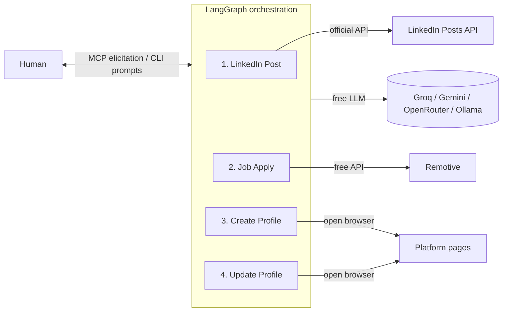

# Career Agents 🤖

A **human-in-the-loop** multi-agent career assistant built with **LangChain**,
**LangGraph**, an **MCP server**, and **100% free LLMs**.

Four agents help you grow your career — but **a human approves every real action**
(posting, applying, creating/updating accounts). Nothing is auto-submitted.

| # | Agent | What it does |
|---|---|---|
| 1 | **LinkedIn Post/Article** | Suggests topics → you pick one → drafts a post or article → you review (approve or request edits) → publishes via the **official LinkedIn API** |
| 2 | **Job Apply** | Reads your tech stack → finds jobs (free Remotive API + search links) → you pick one → drafts a tailored cover letter → you review → opens the posting so **you** apply |
| 3 | **Create Profile** | Drafts profiles tailored for Toptal, Turing, Crossover, Arc.dev, Braintrust, Instahyre, Hirist, Wellfound, Cutshort, GulfTalent, Bayt, Remoteleaf → you review → opens each signup page |
| 4 | **Update Profile** | Refreshes your headline/summary across LinkedIn, Naukri + all the above → you review → opens each profile page to paste & save |

---

## ⚠️ Important: Terms of Service & ethics

LinkedIn, Toptal, Naukri, and the other platforms **prohibit automated scraping,
automated account creation, and auto-applying** in their Terms of Service.
Violating this can get your accounts banned.

This project is deliberately designed to **stay compliant**:

- ✅ LinkedIn **posting** uses only the **official, approved REST API** with *your* OAuth token.
- ✅ Job search uses the **free, public Remotive API** + human-clickable search links.
- ✅ Profile create/update **drafts content** and **opens the page** — the human reviews and submits.
- ❌ No scraping, no stealth automation, no auto-submit, no credential filling.

Keep it this way. The value is in the AI drafting + orchestration, not in breaking ToS.

---
## 🏗️ Architecture



Each agent is a LangGraph graph that pauses at interrupt() for human reviewand resumes after you respond. The MCP server exposes each agent as a tool anduses MCP elicitation for the human-in-the-loop step, so it plugs straight intoVS Code or Claude Desktop

## 🆓 Free LLM options (pick one)

Set `LLM_PROVIDER` in `.env`:

| Provider | Cost | Get a key |
|---|---|---|
| `groq` | Free tier, very fast[cite: 2] | https://console.groq.com/keys[cite: 2] |
| `gemini` | Free tier[cite: 2] | https://aistudio.google.com/apikey[cite: 2] |
| `openrouter` | Has `:free` models[cite: 2] | https://openrouter.ai/keys[cite: 2] |
| `ollama` | 100% free, local, offline, **no key**[cite: 3] | https://ollama.com[cite: 3] |
For zero accounts and zero dollars, use **ollama**: `ollama pull llama3.1`[cite: 3].

---

## 🛠️ Setup

```bash
# 1. Create a virtual env
python -m venv .venv
.venv\Scripts\activate          # Windows
# source .venv/bin/activate     # macOS/Linux
# 2. Install
pip install -e .
# 3. Configure
copy .env.example .env          # Windows  (cp on macOS/Linux)
copy config\profile.example.json config\profile.json
#   -> edit .env (add ONE free LLM key)
#   -> edit config/profile.json (your real details)
💻 Use it - CLI
Bash
career-agents list
career-agents run linkedin_post
career-agents run job_apply
career-agents run create_profile
career-agents run update_profile
At each checkpoint the terminal shows the draft/topics/jobs and asks for your
response, Type approve, or type the changes you want, or type a number to choose.

🛜 Use it - MCP (VS Code / Claude Desktop)
A ready config is in [.vscode/mcp.json](.vscode/mcp.json). In VS Code open the
MCP: List Servers command, start career-agents, then invoke a tool like
`linkedin_post_agent` in chat. The human-in-the-loop prompts appear as elicitation
dialogs.

Run the server directly:

```bash
python -m career_agents.mcp_server

🔑 LinkedIn official posting (optional)
1. Create an app at https://www.linkedin.com/developers/apps   
2. Request the Share on LinkedIn product (w_member_social).   
3. Generate an access token for your account.   
4. Put LINKEDIN_ACCESS_TOKEN and LINKEDIN_AUTHOR_URN (urn:li:person:XXXX) in .env.   


Without these, the post agent runs in dry-run mode (drafts but never posts).   


## 🚀 Deploy for FREE (no dollar cost)[cite: 4]

Because the agents are **interactive** (they wait for you), the best "deployment"[cite: 4]
is lightweight. Options, cheapest first:[cite: 4]

1. **Local (recommended, truly $0)** — run the CLI or MCP server on your machine
   with **ollama** as the LLM. No cloud, no keys, no cost.[cite: 4]
2. **GitHub Actions (scheduled drafts, $0)** — the included workflow
   `[.github/workflows/profile-refresh-reminder.yml](.github/workflows/profile-refresh-reminder.yml)`
   runs weekly on GitHub's free runners, generates fresh profile/update drafts,
   and opens a GitHub Issue with them for you to review and apply. Add your free
   LLM key as a repo **secret** (`GROQ_API_KEY`, etc.).

3. **Hugging Face Spaces (free tier)** — wrap a simple Gradio UI around the graphs
   and host it free. Good if you want a web form for the review steps.

4. **Oracle Cloud Always-Free VM / Google cloud e2-micro free tier** — run Ollama +
   the MCP server on an always-free VM for a persistent self-hosted setup.

5. **Render / Railway / Fly.io free tiers** — fine for the MCP server, but note
   these need an interactive client to answer the human-in-the-loop prompts.

> 💡 All LLM usage stays free by using Groq/Gemini/OpenRouter free tiers or local
> Ollama. The only thing that can ever cost money is LinkedIn's official API (it's
> free for basic member posting) — nothing here requires a paid plan.

---

## 🧪 Tests

```bash
pip install pytest
pytest -q

The smoke tests need no API keys — they verify all four graphs compile, that
LinkedIn posting is a safe dry-run without credentials, and that job search returns
links even offline.

---

## 📁 Project layout

---

src/career_agents/
├── config.py              # settings + profile loader[cite: 6]
├── llm.py                 # free-LLM factory (groq/gemini/openrouter/ollama)[cite: 6]
├── state.py               # shared LangGraph state[cite: 6]
├── graph.py               # agent registry + compile helper[cite: 6]
├── main.py                # CLI (human-in-the-loop loop)[cite: 6]
├── mcp_server.py          # MCP server (human-in-the-loop via elicitation)[cite: 6]
├── agents/
│   ├── linkedin_post_agent.py
│   ├── job_apply_agent.py
│   ├── profile_create_agent.py
│   └── profile_update_agent.py
└── tools/
    ├── linkedin_api.py    # official LinkedIn REST API[cite: 6]
    ├── job_boards.py      # free Remotive API + search links[cite: 6]
    └── browser.py         # opens platform pages for the human[cite: 6]
---

---

## 📜 License

Use responsibly and within each platform's Terms of Service[cite: 6].